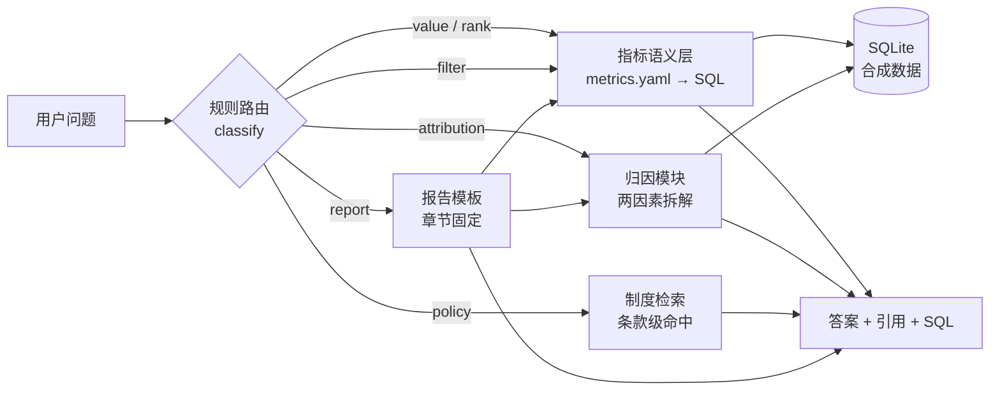

# BizLens — 企业经营分析 Copilot


把"这个季度哪个项目亏了、为什么、接下来怎么办"变成一个可以追问、可以追溯、可以复核的流程。

系统接收自然语言问题，在受控的指标语义层上取数，生成带引用的结论和报告。数字全部由 SQL 计算，模型不参与算术。

> 仓库内的企业、系统、人员、数据均为虚构或合成，不含任何真实客户信息。

## 为什么做

月度经营会上的典型问题要跨三个系统取数、手工对两套口径、再花半天写材料。更麻烦的是每个数字都说不清来源，结论因此不敢拿去决策。

这套系统把三件事固定下来：

1. 口径只在一个地方定义（`data/metrics.yaml`），改一处，所有查询和报告同步变。
2. 每个数字都带引用，能回到具体指标、表和时间范围。
3. 报告由结构化数据渲染，不是模型自由发挥，因此可以 diff、可以审。

## 能做什么

| 能力 | 问法示例 | 输出 |
|---|---|---|
| 单指标查询 | "2025 年 Q4 华东区域的确认收入是多少？" | 一个数 + 口径 + 引用 |
| 对比与排名 | "Q4 毛利率最低的 5 个项目是哪些？" | 表格（含排序规则） |
| 异常识别 | "毛利率低于 10% 且回款率低于 70% 的项目有哪些？" | 清单 + 制度依据 |
| 归因分析 | "P-117 毛利率下降，是收入端还是成本端造成的？" | 两因素拆解 + 数字 |
| 制度问答 | "合同首付款比例上限是多少？" | 条款原文 + 条款号 |
| 报告生成 | "生成 2025 年 Q4 华东区域经营分析报告" | 固定结构的 Markdown |

## 快速开始

```bash
python scripts/gen_seed.py       # 生成合成数据（固定种子 20251103）
python scripts/build_tasks.py    # 生成 60 条评测任务
python scripts/selftest.py       # 9 条冒烟断言

python src/cli.py "2025 年 Q4 毛利率低于 10% 的项目有哪些？"
python src/cli.py --sql "生成 2025 年 Q4 华东区域经营分析报告"

python src/demo_server.py        # 打开 http://127.0.0.1:8765
python src/eval_runner.py        # 跑全量评测
```

只依赖 Python 标准库和 pandas。不需要 API Key，不联网。

## 架构



路由只决定走哪条路，不做计算；聚合、除法、NULL 处理都在语义层。

## 评测结果

| 集子 | 结果 | 说明 |
|---|---|---|
| 主任务集（60 条，6 类） | 60/60 | 规则覆盖了模板问法，不代表泛化 |
| 改写集（10 条，换说法） | 3/10 | 换个说法就不行，这是当前的真实水平 |
| 封存集（8 条） | 未运行 | 留到发布前跑一次 |

主集满分的原因很直接：任务和路由出自同一套模板。改写集才是照妖镜，"第四季度"不认识 Q4、"五个项目"不认中文数字、"在职员工"不在词典里。这些失败记录在 `eval/report_paraphrase.md`。

## 目录

```
.
├── src/
│   ├── common/yamlish.py     # 零依赖 YAML 解析
│   ├── semantics/layer.py    # 指标 → SQL、筛选、排名、环比
│   ├── analytics.py          # 两因素拆解、贡献度、结构分析
│   ├── policy.py             # 制度条款检索
│   ├── report.py             # 9 种报告模板
│   ├── engine.py             # 路由 + 执行 + 答案组装
│   ├── router.py             # 取数与排名的规则解析
│   ├── intent/               # LLM 解析器（接口已写，未联调）
│   ├── cli.py                # 命令行
│   ├── demo_server.py        # 最小 Web 界面
│   └── eval_runner.py        # 评测执行
├── data/
│   ├── seed/                 # 合成数据（7 张表）
│   ├── metrics.yaml          # 9 个指标 + 5 条口径冲突决策
│   └── policy.md             # 10 条制度条款
├── eval/                     # 任务集、改写集、封存集、评测报告
├── scripts/                  # 数据生成、任务生成、自检
└── docs/                     # 设计文档、评测设计、开发日志
```

## 设计取舍

完整决策记录在 `data/metrics.yaml` 的 `conflicts_resolved`：

1. **毛利率不摊管理费用**：摊了项目经理无法负责，分摊比例一变历史数据全失真。
2. **回款率分母用开票，不用收入**：否则出现"没开票也要收钱"的伪指标。
3. **人均产值用期末人数**：与人力月报一致，避免两套人数。
4. **跨期调整不追溯**：历史报表已报送，重算会前后不一致。
5. **合同额含税、收入不含税**：两者不可相减，报告必须分列。

## 已知限制

- 规则路由只认受控问法，自由表达失败率高（改写集 3/10）
- LLM 解析器有代码但未联调（本机无 Key、无外网）
- 30 个项目的合成数据，够验证链路，不够证明泛化
- 归因自动判定只看结论方向，报告只看章节与数字，文案质量需人工评
- 没有权限体系、没有并发处理、报告是模板而非生成式

## 文档

- [方案书](docs/01-方案书.md)：问题、边界、架构、取舍、价值测算
- [评测设计](docs/02-评测设计.md)：任务集、评分规则、指标定义
- [数据与合规](docs/03-数据与合规.md)：合成数据、口径治理、权限与审计
- [实施计划](docs/04-实施计划.md)：8 周排期与砍范围策略
- [竞品与成本](docs/05-竞品与成本.md)：四条路线对比、成本模型
- [开发日志](docs/06-开发日志.md)：分阶段记录与踩坑
