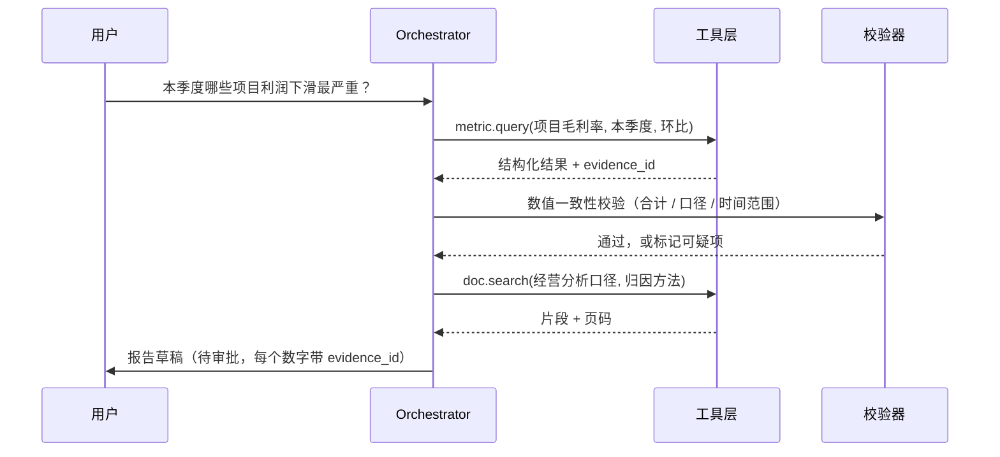

# BizLens：面向项目型企业的经营分析 Copilot

> 状态：设计与实现已完成，代码见 src/，数据见 data/
> 全文不含真实企业、系统或数据。

## 1. 问题：经营分析慢在"取数"和"对口径"，不是慢在"写"

一家项目型 B2B 企业的月度经营会，通常这样开场：

> "本季度哪些项目利润下滑最严重？为什么？下季度怎么办？"

这个问题看起来简单，实际要跨 3 个系统、5 张表、2 套口径：

| 环节 | 现状 | 耗时占比 |
|---|---|---|
| 找数据 | 财务、项目、合同系统各查一遍，字段名不一致 | ~40% |
| 对口径 | "毛利"是含税还是不含税？是否分摊管理费用？ | ~30% |
| 写结论 | 复制进 Excel/PPT，手工做排名和图表 | ~20% |
| 复核 | 领导追问某一个数字的来源 | ~10% |

**真正的痛点是：每次分析都要重新解释一遍"这个数是怎么来的"。**

这带来三个可量化的损失：分析周期长（以天计）、口径不一致导致会上吵架、结论无法追溯所以不敢用于决策。

## 2. 用户与场景

| 角色 | 典型任务 | 频次 | 对 AI 的核心诉求 |
|---|---|---|---|
| 经营分析 / 财务 BP | 月度经营分析、异常项目排查 | 每周 | 快、数对、能解释 |
| 业务负责人 | 看自己条线的项目健康度 | 每周 | 说人话、给动作建议 |
| 管理层 | 季度经营会材料 | 每季 | 可信、可审批、可留痕 |
| 财务/审计 | 复核数字来源 | 按需 | 每个数字能点回到源头 |

**场景优先级**（价值 × 可行性，非拍脑袋）：

| 场景 | 价值 | 可行性 | 优先级 |
|---|---|---|---|
| 单指标查询与趋势 | 中 | 高 | P0 |
| 多指标对比与排名 | 高 | 高 | P0 |
| 异常识别与归因 | 高 | 中 | P1 |
| 制度/口径问答 | 中 | 高 | P1 |
| 经营报告生成 | 高 | 中 | P1 |
| 多步方案生成与测算 | 很高 | 低 | P2（先不做） |

## 3. 方案概述与边界

**一句话**：用户用自然语言提问，系统在**受控的指标语义层**上取数，做异常检测与归因，生成**带引用的结构化报告草稿**，经人工审批后归档。

**做什么**：

- 把自然语言问题映射到已定义的指标与维度
- 执行只读查询，返回数字 + 口径 + 数据时间 + 来源
- 识别异常、给出候选归因（每条归因附带证据）
- 生成报告草稿（结论、图表数据、建议动作），进入审批
- 记录全过程，支持回放与追责

**明确不做**（写进方案，避免范围蔓延）：

- 不做预测/预算编制（数据量与责任边界都不支持）
- 不做自动执行（不改业务系统数据）
- 不做开放式取数（不允许模型自由写 SQL 访问任意表）
- 不做多租户与复杂权限体系（POC 阶段用行级白名单）

## 4. 架构


一次典型调用的时序：



## 5. 关键决策与取舍

| # | 决策 | 选择 | 主要理由 | 代价 / 何时反悔 |
|---|---|---|---|---|
| D1 | 取数方式 | **指标语义层优先**，模型只做"选指标"，不写 SQL | 口径可治理、结果可复现、审计可解释 | 覆盖不了临时问题 → 保留受控 Text-to-SQL 兜底（只读、白名单、LIMIT） |
| D2 | Agent 形态 | **单 Agent + 工具**，不做 Supervisor 多 Agent | 一个分析请求本质是串行链路，多 Agent 只增加延迟与失败面 | 当需要并行核查（数据+制度+历史案例）且单链路超时，再拆子 Agent |
| D3 | 报告生成 | **结构化 JSON + 模板渲染**，不让模型直接写 Markdown | 可校验、可 diff、可审批、可回放 | 表达力受限 → 允许"叙述段落"由模型生成，但数字与结论必须来自结构体 |
| D4 | 技术选型 | 自研编排层，**不套 Dify/Coze** | 需要指标语义层、行级权限、审计、评测四件套，低代码平台给不了 | 若只做 POC 演示，低代码更快；正式交付再自研 |
| D5 | 数据 | **合成数据 + 公开财报口径** | 不碰任何真实企业数据，作品可公开 | 数据分布不真实 → 用公开行业报告校准量级，并在报告中声明 |

**D2 的展开**（这是最容易被追问的一条）：

默认单 Agent。只有同时满足以下条件才拆：

1. 子任务之间**确实可并行**（如同时查数据、查制度、查历史案例），串行会超时；
2. 子任务需要**不同的工具集与权限**；
3. 有独立的**质量校验点**，能分别评估。

否则多 Agent 等于把一次函数调用拆成三次网络往返，还多出状态同步和错误传播。

## 6. 可信性设计（企业客户真正买单的部分）

| 机制 | 做法 | 解决的问题 |
|---|---|---|
| 数字可追溯 | 每个数字带 `evidence_id`，可点回 SQL、表、时间范围 | "这个数哪来的" |
| 口径唯一 | 指标定义集中管理，带版本和负责人 | 会上对不上数 |
| 数值校验 | 合计校验、同比环比合理性、跨表交叉验证 | 模型或 SQL 出错 |
| 权限前置 | 行级权限在查询层生效，不依赖提示词 | 越权看数据 |
| 强制人审 | 高金额、低置信度、跨期调整 → 必须人工确认 | 责任边界 |
| 全程留痕 | 提问、工具调用、结果、审批意见全记录 | 审计与复盘 |

## 7. 评测与验收

不做"演示三个 case 就算成功"。评测集、评分规则、回归流程见 [评测设计](02-评测设计.md)。

对外承诺的验收线（POC 阶段）：

- 任务成功率 ≥ 80%（60 条任务集）
- 关键数值准确率 ≥ 95%（与基准表对账）
- 引用可追溯率 100%（每个数字能点回来源）
- P95 端到端时延 ≤ 30 秒
- 单任务成本 ≤ ¥0.5

以上为**目标值**，实测结果在 `eval/report.md` 更新。

## 8. 价值测算（假设，需实测校准）

```
年化收益 = 单次节省工时 h × 年分析次数 n × 使用人数 p × 人力成本 c − 年运行成本
```

算例（全部为假设值，标注清楚）：

- h = 3 小时/次（取数 1.2 + 对口径 0.9 + 写报告 0.6 + 复核 0.3）
- n = 40 次/年/人，p = 5 人，c = ¥150/小时
- 年运行成本 ≈ ¥16,000（模型 ¥3,000 + 基础设施 ¥3,000 + 维护 0.5 人月 ¥10,000，详见[竞品与成本](05-竞品与成本.md)）

年化收益 ≈ 3 × 40 × 5 × 150 − 16,000 ≈ **¥74,000**

结论是：**价值主要来自"口径统一"和"复核成本下降"，不在"少写几页 PPT"**。这个判断本身比数字重要。

## 9. 风险与应对

| 风险 | 表现 | 应对 |
|---|---|---|
| 幻觉 | 编造数字或归因 | 数字只来自工具返回；归因必须附证据；无证据时明确说"无法归因" |
| 口径不一致 | 系统算的和财务算的不一样 | 指标语义层由财务负责人签字确认，版本化管理 |
| 数据质量 | 源系统缺数、重复、滞后 | 查询前做完整性检查，缺数时降级为"部分结论"并标注 |
| 权限越权 | 看到不该看的数据 | 查询层行级过滤 + 审计日志 |
| 成本失控 | 反复追问导致调用量爆炸 | 单次会话预算、缓存、超限降级 |
| 组织不信任 | 业务方不愿用 | 先做"辅助草稿"定位，不替代人；用一次真实会议验证 |

## 10. 落地路径

| 阶段 | 周期 | 范围 | 验收 |
|---|---|---|---|
| POC | 2 周 | 1 个部门、3 个场景、合成数据 | 3 个场景跑通，业务方认可"数是对的" |
| 试点 | 6 周 | 1 条业务线、接入真实只读库 | 评测达标，每周实际使用 ≥ 10 次 |
| 推广 | 1 季度 | 多部门、接审批流 | 月度经营会使用，人工修改率 ≤ 20% |

详细排期与砍范围策略见 [实施计划](04-实施计划.md)。
